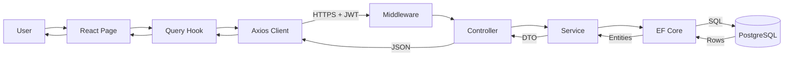
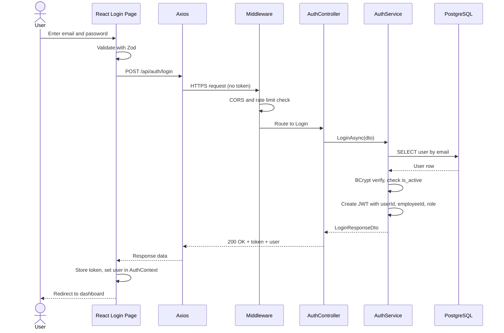
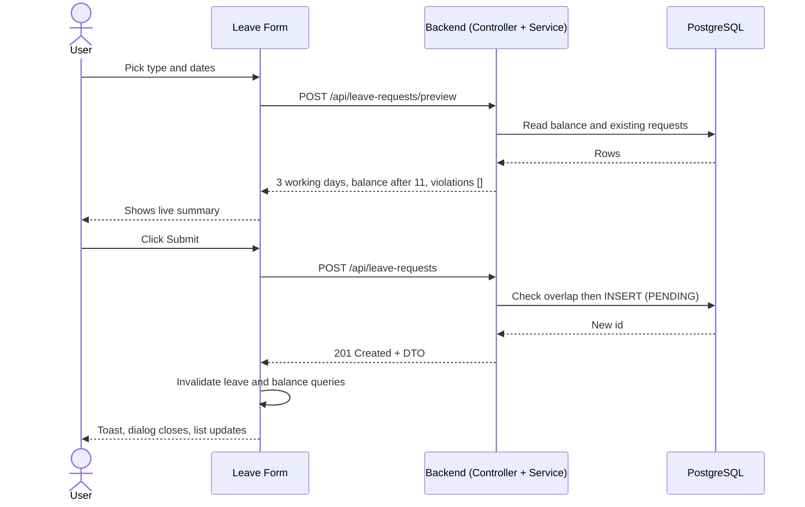
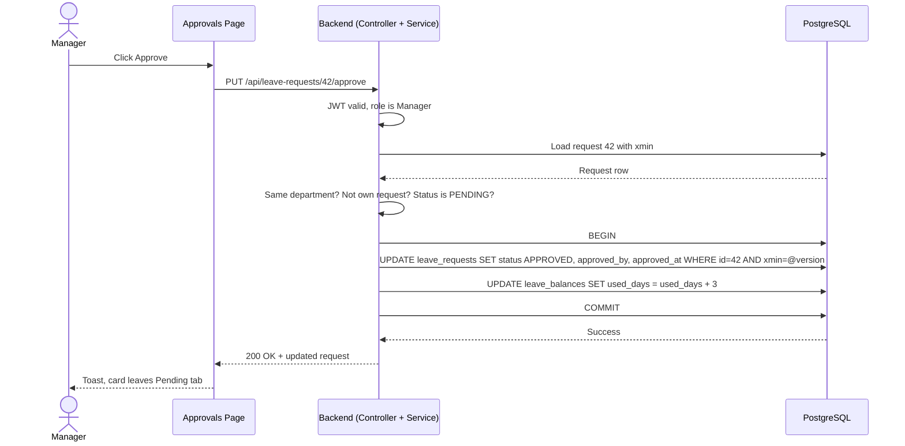

# Request and Response Flow: Frontend, Backend and Database

How a user action travels through every layer of the Employee Leave & Attendance Management System, and how the response travels back.

---

## 1. The big picture

```
 USER (browser)
   |  click / type
   v
+-------------------------------------------------------------+
| FRONTEND   React + TypeScript                               |
|   Page -> Form (validation) -> Query hook -> Axios client   |
+-------------------------------------------------------------+
   |  HTTPS request, JSON body, Authorization: Bearer <JWT>
   v
+-------------------------------------------------------------+
| BACKEND   ASP.NET Core Web API                              |
|   Middleware -> Controller -> Service -> EF Core DbContext  |
+-------------------------------------------------------------+
   |  SQL over Npgsql (parameterised)
   v
+-------------------------------------------------------------+
| DATABASE   PostgreSQL                                       |
|   users, employees, departments, attendance,                |
|   leave_types, leave_requests, leave_balances               |
+-------------------------------------------------------------+
   |  rows
   v
 ...the same path in reverse: Entity -> DTO -> JSON -> UI update
```



The frontend never talks to the database. Only the backend does. The frontend and backend communicate only through the REST API.

---

## 2. What each layer does

| Layer | Component | Responsibility | Must not |
|---|---|---|---|
| Frontend | Page / component | Show UI, collect input | Contain business rules |
| Frontend | React Hook Form + Zod | Validate input before sending | Be trusted as security |
| Frontend | TanStack Query hook | Call the API, cache results, track loading and error state | Hold secrets |
| Frontend | Axios client | Add the JWT, handle 401, parse errors | |
| Backend | Middleware | Exception handling, logging, CORS, rate limiting, authentication | Contain feature logic |
| Backend | Controller | Receive HTTP, bind and validate the DTO, check role attributes, call a service, return a status code | Contain business logic or queries |
| Backend | Service | Enforce business rules and resource-level authorization, manage transactions, map to DTOs | Know about HTTP |
| Backend | EF Core (DbContext) | Translate C# queries and changes into SQL, track entities | Make business decisions |
| Database | PostgreSQL | Store data, enforce constraints (unique, foreign keys, checks), run transactions | |

---

## 3. Request lifecycle, step by step

Example: an employee clicks **Submit** on the leave form.

### Frontend (steps 1 to 5)

1. **User action.** The user fills the form and clicks Submit.
2. **Client validation.** React Hook Form and Zod check required fields and date order. Invalid input stops here with inline errors. No network call is made.
3. **Mutation hook.** `useMutation` (TanStack Query) marks the button as loading and calls the API function.
4. **Axios request.** The client builds the HTTP request and the interceptor adds the token.
5. **Network.** The request leaves the browser over HTTPS.

```http
POST /api/leave-requests HTTP/1.1
Host: api.example.com
Authorization: Bearer eyJhbGciOi...
Content-Type: application/json

{
  "leaveTypeId": 1,
  "startDate": "2026-10-20",
  "endDate": "2026-10-22",
  "reason": "Family event"
}
```

### Backend (steps 6 to 12)

6. **Middleware pipeline** (in order):
   1. Global exception handler wraps everything below it.
   2. HTTPS redirection and HSTS.
   3. CORS: is the request origin the configured frontend origin?
   4. Rate limiter (strictest on the login endpoint).
   5. **Authentication:** validate the JWT signature, issuer, audience and expiry. Failure returns **401**.
   6. **Authorization:** does the role satisfy the endpoint policy? Failure returns **403**.
7. **Routing** selects `LeaveRequestsController.Create`.
8. **Model binding and validation.** The JSON becomes a `CreateLeaveRequestDto`. Invalid data returns **400** with field errors.
9. **Controller** reads the employee id from the JWT claims (never from the request body) and calls `LeaveService.CreateAsync(employeeId, dto)`.
10. **Service** applies the business rules (Section 5 of the documentation):
    - employee and leave type exist and are active
    - date rules and year-boundary rule
    - working-day calculation (Mon to Fri, half-day)
    - no overlap with PENDING or APPROVED requests
    - balance check (remaining minus pending days)
    - Any violation throws `BusinessRuleException` (400) or `ConflictException` (409).
11. **EF Core** turns the C# operations into SQL.
12. **Npgsql** sends the parameterised SQL to PostgreSQL.

### Database (step 13)

13. PostgreSQL checks constraints, writes the row and returns the result.

```sql
-- overlap check (simplified)
SELECT 1 FROM leave_requests
WHERE employee_id = @p0
  AND status IN ('PENDING', 'APPROVED')
  AND start_date <= @p2 AND end_date >= @p1;

-- insert
INSERT INTO leave_requests
  (employee_id, leave_type_id, start_date, end_date, total_days, reason, status, created_at)
VALUES (@p0, @p1, @p2, @p3, @p4, @p5, 'PENDING', @p6)
RETURNING id;
```

---

## 4. Response lifecycle (the way back)

| Step | Where | What happens |
|---|---|---|
| 14 | PostgreSQL | Returns the new row id (or a constraint error) |
| 15 | EF Core | Maps the result back to the `LeaveRequest` entity |
| 16 | Service | Maps the entity to a `LeaveRequestResponseDto` (adds leave type name, employee name, and so on; omits internal fields) |
| 17 | Controller | Returns `201 Created` with the DTO |
| 18 | Middleware | Serializes to JSON, adds headers, logs the request |
| 19 | Axios | Receives the response and passes the data to the hook |
| 20 | TanStack Query | Stores the result, **invalidates** the cached leave list and balances so they refetch |
| 21 | React | Re-renders: closes the dialog, shows a success toast, updates the table and balance cards |

```http
HTTP/1.1 201 Created
Content-Type: application/json

{
  "id": 42,
  "leaveType": "Annual Leave",
  "startDate": "2026-10-20",
  "endDate": "2026-10-22",
  "totalDays": 3.0,
  "status": "PENDING",
  "createdAt": "2026-10-13T08:41:12Z"
}
```

---

## 5. How the data changes shape at each layer

```
Form fields (React state)
   -> JSON text (HTTP body)
   -> CreateLeaveRequestDto (C# object, validated)
   -> LeaveRequest entity (C# object, tracked by EF Core)
   -> SQL INSERT with parameters
   -> row in leave_requests (PostgreSQL)
   -> LeaveRequest entity (loaded by EF Core)
   -> LeaveRequestResponseDto (C# object)
   -> JSON text (HTTP body)
   -> TypeScript object (parsed by Axios)
   -> rendered table row (React)
```

| Layer | Representation |
|---|---|
| Browser | TypeScript objects and form state |
| Network | JSON text |
| Controller | DTO classes (what the API accepts and returns) |
| Service and EF Core | Entity classes (what the database stores) |
| Database | Table rows |

DTOs and entities are separate on purpose. The API never returns an entity directly, so fields such as `password_hash` can never leak.

---

## 6. Example A: Login



Failure paths:

| Case | Backend | Frontend |
|---|---|---|
| Wrong email or password | 401 with a generic message | Inline "Incorrect email or password" |
| Inactive account | 403 | "Your account is disabled" |
| Too many attempts | 429 | "Too many attempts, try again shortly" |

From now on, every request carries `Authorization: Bearer <token>`.

---

## 7. Example B: Live leave preview, then submit



The preview endpoint runs the same rules as the real one but saves nothing. This is why the UI can warn about an overlap or an insufficient balance before the user submits.

---

## 8. Example C: Manager approves leave (transaction and concurrency)



What protects the data:

- **Resource check in the service:** a manager can approve only requests from their own department, and never their own request (403 otherwise).
- **One transaction:** the status change and the balance deduction succeed together or not at all.
- **Concurrency token (`xmin`):** if two people approve at the same moment, the second `UPDATE` matches zero rows. EF Core throws a concurrency exception, the service turns it into a `ConflictException`, and the API returns **409**. The UI shows "This request was already decided" and refreshes the list.

---

## 9. Example D: Check-in

```
Employee clicks "Check in"
 -> POST /api/attendance/check-in            (no body; identity comes from the JWT)
 -> AttendanceController.CheckIn
 -> AttendanceService.CheckInAsync(employeeId)
      - is it a working day (Mon to Fri)?
      - already checked in today? (also protected by a unique index)
      - status = LATE if time is after Attendance__LateAfter, else PRESENT
 -> INSERT INTO attendance (employee_id, attendance_date, check_in, status)
      unique (employee_id, attendance_date) prevents duplicates
 <- 201 Created { checkIn: "...", status: "PRESENT" }
 -> UI: button changes to "Check out", worked-time timer starts
```

If the user double-clicks, the second request hits the unique index or the service check and returns **409**, and the UI shows "You have already checked in today".

---

## 10. Error flow

Every error follows the same path, so the UI can handle it the same way everywhere.

```
Anywhere in service or database code
   -> throws NotFoundException / ConflictException / BusinessRuleException / ForbiddenException
   -> exception middleware catches it
   -> converts it to a ProblemDetails JSON response
   -> Axios receives a non-2xx response
   -> the hook exposes the error
   -> the UI shows a toast or inline field errors
```

```json
{
  "title": "Insufficient leave balance",
  "status": 400,
  "detail": "You requested 5 days but only 3 days remain for Annual Leave.",
  "errors": { "endDate": ["Choose an earlier end date or a different leave type."] }
}
```

| Status | Meaning | UI behaviour |
|---|---|---|
| 400 | Validation failed or a business rule was broken | Show field errors or the detail message |
| 401 | Missing, invalid or expired token | Clear the token, go to login with "Your session expired" |
| 403 | Authenticated but not allowed | Show the 403 page or a "not permitted" message |
| 404 | Not found | Show a not-found message |
| 409 | Conflict (overlap, duplicate check-in, double approval) | Show a friendly message and refresh the data |
| 429 | Rate limited | Ask the user to wait |
| 500 | Unexpected error | Generic message; details are only in the server log |

---

## 11. Where security is enforced

| Layer | Checks |
|---|---|
| Frontend | Hides menu items and buttons the role cannot use. This is convenience only. |
| Middleware | JWT signature, issuer, audience and expiry; CORS origin; rate limiting |
| Controller | Role policy attributes (`Admin`, `Manager`, `Employee`) |
| Service | Resource-level rules: employees see only their own data, managers only their department, no self-approval |
| Database | Unique indexes, foreign keys, check constraints, transactions |

The backend always enforces permissions, even when the UI hides a button. Anyone can call the API directly, so the UI is never a security boundary.

---

## 12. Where the code lives

| Concern | Location |
|---|---|
| Pages and components | `frontend/.../src/pages`, `components` |
| API calls and Axios client | `frontend/.../src/services` |
| Query hooks | `frontend/.../src/hooks` |
| TypeScript types (match the DTOs) | `frontend/.../src/types` |
| Controllers | `backend/EmployeeManagement.API/Controllers` |
| Services and interfaces | `Services`, `Interfaces` |
| DTOs | `DTOs` |
| Entities | `Models` |
| DbContext and configuration | `Data` |
| Exception handling middleware | `Middleware` |
| Database schema | `Migrations` |

---

## 13. One-line summary

**Browser -> React (validate) -> Axios (add token) -> Middleware (auth) -> Controller (bind DTO) -> Service (business rules) -> EF Core (SQL) -> PostgreSQL (constraints, transaction) -> back up as rows -> entity -> DTO -> JSON -> React re-renders.**
